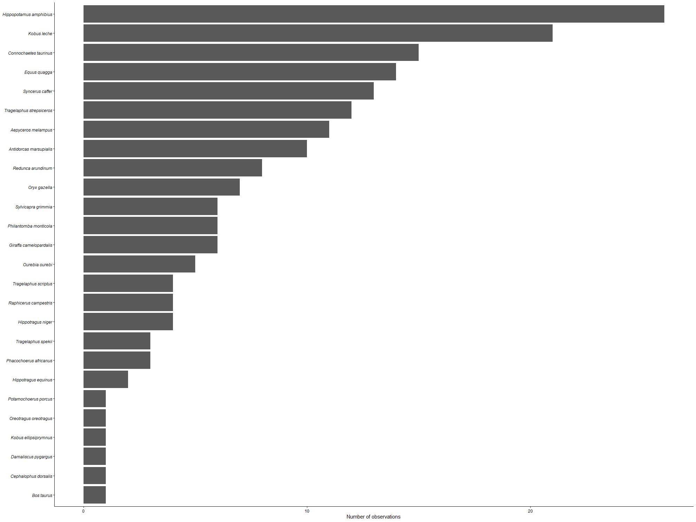

## Objetivo

Aprender a importar, ordenar, limpiar y transformar datos en R mediante funciones de tidyverse, para organizar información climática y registros de especies, generar gráficos y tablas, y guardar los datos procesados.

## Materiales y herramientas

- RStudio, lenguaje R.

- Paquetes tidyverse, gt y lobstr.

- Archivos CSV con datos climáticos y observaciones de ungulados.

- Funciones para manipular datos, generar visualizaciones y exportar archivos RDS y TIFF.

## Procedimiento

Se importaron los archivos CSV y se revisó su estructura. Después, se reorganizaron los datos con pivot_longer() y pivot_wider(), se corrigieron nombres de columnas y variables, se crearon fechas con unite() y as_date(), y se separaron valores con separate(). Posteriormente, se convirtieron variables a formato numérico, se dividieron los datos en listas y se guardaron en archivos RDS. Finalmente, se elaboraron gráficos con ggplot2 y tablas con gt para resumir y comparar los resultados.

## Resultados

Se obtuvieron conjuntos de datos ordenados, con fechas, variables climáticas y nombres científicos corregidos. Además, se generaron gráficos para comparar temperaturas y frecuencias de observaciones por especie, tablas de resumen y archivos RDS con información separada en listas para facilitar su reutilización.

## Figuras y tablas

{width="601"}

## Reflexión final

Aprendí a limpiar, transformar y organizar datos con R, separar información taxonómica y generar gráficos y tablas. Una dificultad fue corregir formatos inconsistentes, convertir variables a valores numéricos y estructurar los datos adecuadamente. En el estudio de roedores, estas herramientas permitirían organizar registros de especies, analizar su distribución y abundancia, y relacionar las observaciones con variables ambientales como temperatura, precipitación y elevación.

## Conclusiones

El uso de R permitió transformar datos desordenados en conjuntos estructurados, facilitando su análisis y representación gráfica. Las funciones de `tidyverse` simplificaron la limpieza y reorganización de los datos, mientras que `ggplot2` y `gt` permitieron presentar los resultados de manera clara. Estas herramientas son útiles en ecología para estudiar patrones de distribución y abundancia de especies y explorar su relación con las condiciones ambientales.

## Referencias bibliográficas

- Posit. (s. f.). Tidyverse: Easily install and load the tidyverse. [https://www.tidyverse.org/](https://www.tidyverse.org/?utm_source=chatgpt.com)⁠

- Tidyverse. (s. f.). Pivot data from wide to long: `pivot_longer()`. GitHub. [Consultar documentación](https://github.com/tidyverse/tidyr/blob/main/man/pivot_longer.Rd?utm_source=chatgpt.com)⁠.

- Tidyverse. (s. f.). Pivot data from long to wide: `pivot_wider()`. [https://tidyr.tidyverse.org/reference/pivot_wider.html](https://tidyr.tidyverse.org/reference/pivot_wider.html?utm_source=chatgpt.com)⁠

- Wickham, H., & Bryan, J. (s. f.). Save a ggplot (or other grid object) with sensible defaults: `ggsave()`. ggplot2. [https://ggplot2.tidyverse.org/reference/ggsave.html](https://ggplot2.tidyverse.org/reference/ggsave.html?utm_source=chatgpt.com)⁠
