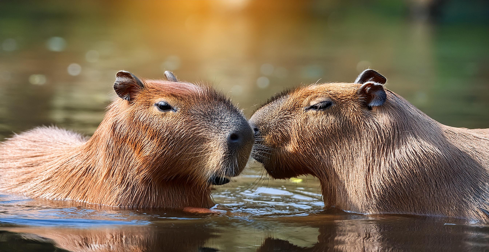

::: {.perfil-superior}

::: {.perfil-foto}

{fig-alt="Fotografía de perfil"}

:::

::: {.perfil-info}

# Arianna Blanco

## Estudiante de Bachillerato en Biología Tropical

Escuela de Ciencias Biológicas  
Universidad Nacional, Costa Rica

::: {.enlaces-perfil}

[<i class="bi bi-envelope-fill"></i> Correo](mailto:arianna.blanco.fuentes@est.una.ac.cr)

[<i class="bi bi-github"></i> GitHub](https://github.com/CapybaraGP)

[<i class="bi bi-person-badge-fill"></i> ORCID](https://orcid.org/0000-0000-0000-0000)

[<i class="bi bi-linkedin"></i> LinkedIn](https://linkedin.com/in/usuario)

:::

:::

:::

---

## Biografía

Escriba un breve párrafo (100–150 palabras) donde describa quién es, su formación académica, sus principales intereses científicos y sus metas profesionales.
Soy estudiante de Biología con un interés particular en la fauna silvestre y la investigación científica. Me apasionan los capibaras y los micromamíferos, grupos que despiertan mi curiosidad por su comportamiento, distribución, diversidad y ecología. Trabajo en un libro sobre micromamíferos, proyecto que me permite profundizar en la diversidad de estas especies y ampliar mis conocimientos sobre ellas.
También tengo un fuerte interés por la histología, área que me permite estudiar con detalle las estructuras y características microscópicas de los organismos. Me gusta combinar diferentes enfoques para comprender mejor a las especies, desde el análisis de datos ecológicos y poblacionales hasta el estudio de estructuras anatómicas a nivel microscópico. Disfruto los proyectos que me permiten investigar organismos poco conocidos y descubrir aspectos interesantes de su biología.
---

## Áreas de interés

- Ecología
- Conservación
- Biogeografía
- Mastozoología
- Ciencia de datos

---

## Habilidades

- R
- Quarto
- Git y GitHub
- QGIS
- Microsoft Office
- Histología

---

## Formación académica

**Universidad Nacional (UNA)**

Bachillerato en Biología

*2020 – Presente*
