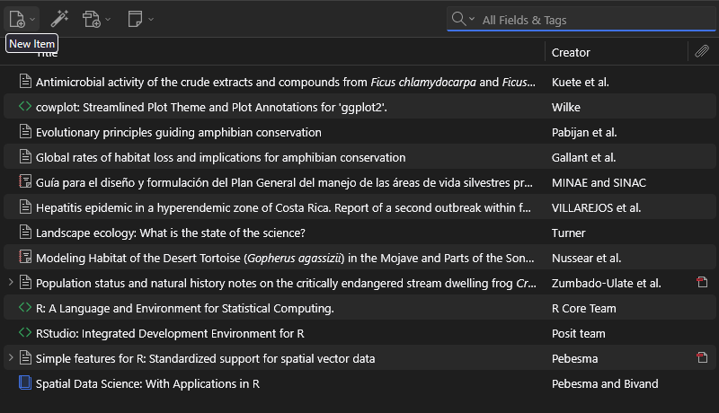

## Introducción

Realizar citaciones con Zootero

## Objetivo

- Al finalizar este tutorial, el estudiante será capaz de:

- Crear y organizar una biblioteca bibliográfica en Zotero.

- Incorporar referencias mediante DOI, archivos RIS y Zotero Connector.

- Revisar y corregir los metadatos de una referencia.

- Instalar y utilizar un estilo bibliográfico.

- Insertar citas y bibliografías automáticamente en Microsoft Word.

- Incorporar referencias que no corresponden a artículos científicos, como reportes, páginas web y software.

- Citar R, RStudio y paquetes de R.

## Metodologia

Se realizo con ayuda de zootero la citacion de referencias bibliográficas

Ademas de citar dichas referencias en el texto

## Resultados

amphibian conservation [@pabijan_evolutionary_2020]

Cuadro 1. Métodos utilizados para incorporar referencias bibliográficas a Zotero.

| Método | ¿Cuándo utilizarlo? |
|------------------------------------|------------------------------------|
| DOI | Cuando la publicación tiene un DOI conocido |
| Archivo RIS | Cuando la revista o base de datos permite exportar la referencia |
| Zotero Connector | Para capturar referencias directamente desde el navegador |
| Entrada manual | Cuando la información no puede importarse automáticamente |

## Conclusiones

Citar en texto y referencias a traves de zootero

## Referencias
